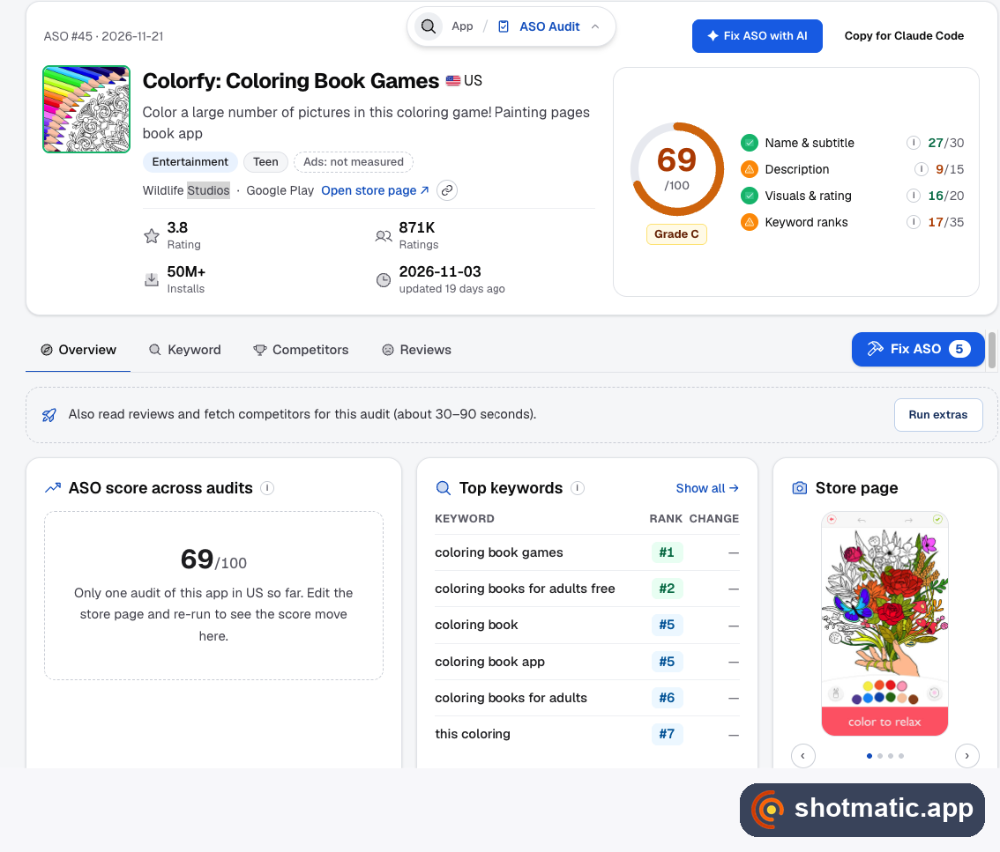

# Colorfy ASO audit: why a 50M-install coloring app scores 69/100

## The short answer

Colorfy: Coloring Book Games scores 69/100 (grade C) in ShotMatic's ASO audit of its US Google Play page. The name and visuals are strong, but it ranks in the top 10 for only 7 of 15 tracked keywords, and its 923-character description never uses its main keyword, "coloring book games".

## What the data shows

- **Score by part:** Name & subtitle 27/30, Visuals & rating 16/20, Description 9/15, Keyword ranks 17/35 (score card, top right).
- **Where it ranks well:** #1 for "coloring book games", #2 for "coloring books for adults free", #5 for "coloring book" and "coloring book app", #6 for "coloring books for adults" (Top keywords).
- **Where it misses:** #28 for "coloring game" and not in the top 50 for "coloring book for kids". Overall 7 of 15 keywords in the top 10 and 8 of 15 in the top 50 [ASO #45 · 2026-11-21].
- **Description gaps:** 923 characters (the audit counts 1,500+ as full), "coloring book games" makes up 0% of its words, the name and subtitle repeat "coloring" and "book", and the release notes only say "Minor bug fixes" [ASO #45 · 2026-11-21].
- **Rating is the weak spot:** 3.8 stars from 870,873 ratings on 50M+ installs, while the top 3 for "coloring book" include Coloring Book: Color by Number (4.5) and Happy Color (4.6) [ASO #45 · 2026-11-21].

## What this means if you build in this niche

Even a 50M-install app leaves free ASO points on the table: a fuller description that actually uses the main keyword, and subtitle words that add new terms instead of repeating the name. If you build a coloring app, the opening is quality, not search terms. Colorfy holds the head keywords on install volume with a 3.8 rating, while the apps beside it sit around 4.5, so a well-rated, focused coloring app can compete on rating and reviews.

## How this was measured

ShotMatic ASO Audit #45, US Google Play, measured 2026-11-21.

[Try ShotMatic free](https://shotmatic.app){ .md-button .md-button--primary }
