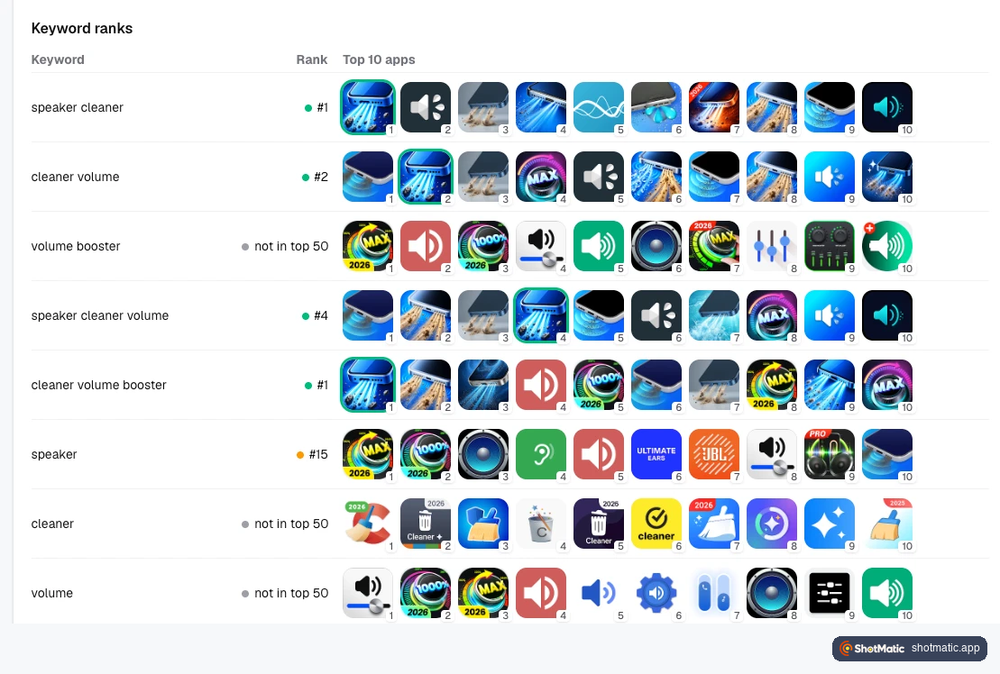

# Top 10 speaker cleaner apps on the App Store: keyword ranks

## The short answer

Yes, "speaker cleaner" can be won on the US App Store, but only through long-tail phrases. In ShotMatic's keyword ranks from November 23, 2026, the tracked app is #1 for "speaker cleaner" and "cleaner volume booster" and #2 for "cleaner volume", yet it is not in the top 50 for broad words like "volume", "cleaner" or "volume booster".

## What the data shows

- **Long-tail phrases are where the tracked app wins:** #1 for "speaker cleaner", #2 for "cleaner volume", #4 for "speaker cleaner volume" and #1 for "cleaner volume booster" (Rank column).
- **The head word "speaker" is harder:** the app sits at #15, and the top 10 includes brand apps such as JBL and Ultimate Ears (row "speaker").
- **Broad words are out of reach:** "volume booster", "cleaner" and "volume" all show *not in top 50*. The "cleaner" top 10 is phone-storage cleaners, a different search intent (row "cleaner").
- **The speaker-cleaner top 10s look alike:** blue water-jet and dusty phone-speaker icons repeat across "speaker cleaner", "cleaner volume" and "speaker cleaner volume", so standing out by icon is hard.
- **"Volume booster" is its own market:** 3 of its top 10 icons carry a "2026" label (#1, #3, #7), and none of the blue water-jet icons from the speaker-cleaner rows appear there.

## What this means if you build in this niche

If you build a speaker cleaner app, aim for the specific phrases people type when water or dust is stuck in their speaker ("speaker cleaner", "cleaner volume booster") instead of broad words like "volume". Those broad words are owned by booster and storage-cleaner apps that answer a different need. And since the top 10 icons look nearly identical, a clearly different icon is a cheap way to get noticed.

## How this was measured

ShotMatic Keyword ranks, US App Store, measured 2026-11-23.

[Try ShotMatic free](https://shotmatic.app){ .md-button .md-button--primary }
